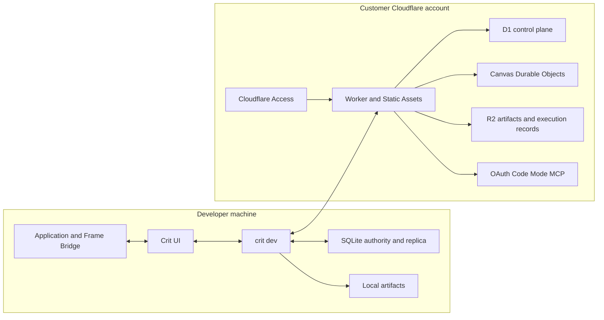

# Cloudflare-native collaborative Crit v1

## Decision

Crit v1 is a clean rewrite. We are optimizing for the best final system, not compatibility with the local-only alpha.

The alpha remains runnable as a behavior reference. The rewrite does not read its Canvas files, preserve its public APIs, retain its package layout, or ship migration adapters. Useful interaction and domain behavior is ported deliberately and proved in the new system.

## Product outcome

Crit is a local-first collaborative review canvas for live applications. The UI is the primary viewing and review surface. v1 is Frames only. Notes and comments are out of the rewrite until we design them again.

Local work is complete without an account:

```sh
npm install --save-dev @riff-refine/crit
npx crit init
npm run dev
```

Sharing adds a remote authority without replacing local authoring:

```sh
npx crit login https://crit.acme.internal
npx crit share checkout-redesign
```

An Agent connects to the customer deployment's `/mcp` endpoint, completes OAuth, and uses the Code Mode `search` and `execute` tools.

## System shape



The canonical record is an ordered Canvas ledger. A local `CanvasReplica` records work immediately, keeps pending intent through restarts, and synchronizes it by stable change ID. The shared authority stamps order and verified attribution.

Frames store logical Representations. An Application Route resolves to localhost for its developer and to a registered preview for a teammate. Canvas history never stores environment bindings or credentials.

## Target packages

```text
packages/
├── domain/           pure commands, projection, identity, Representations
├── protocol/         wire schemas, cursors, sync, bridge, and errors
├── authority/        canonical Canvas authority and conformance tests
├── replica/          optimistic local state, pending work, and rebase
├── representations/  resolution, inspection, capture, and RenderPlan
├── client/           typed HTTP and WebSocket client
├── react/            primary review UI
├── frame-bridge/     framework-neutral browser bridge
├── local/            daemon, SQLite, and local artifacts
├── cloudflare/       Worker, Durable Objects, D1, R2, OAuth, and MCP
└── cli/              init, dev, login, share, sync, and Workspace commands
```

These are ownership boundaries from the first commit. We may begin in one repository, but we do not reproduce the alpha dependency graph inside them.

## Core interfaces

```ts
interface CanvasEngine {
  apply(projection: CanvasProjection, commands: readonly CanvasCommand[]): CanvasTransition
}

interface CanvasAuthority {
  open(canvasId: CanvasId): Promise<AuthorityView>
  submit(intent: ProposedCanvasChange, principal: TrustedPrincipal): Promise<AcceptedCanvasChange>
  changesAfter(canvasId: CanvasId, cursor: Cursor | null): Promise<ChangePage>
  subscribe(canvasId: CanvasId): AsyncIterable<AuthorityHint>
}

interface CanvasReplica {
  open(canvasId: CanvasId): Promise<ReplicaView>
  change(canvasId: CanvasId, commands: readonly CanvasCommand[]): Promise<ReplicaView>
  sync(canvasId: CanvasId): Promise<SyncResult>
  subscribe(canvasId: CanvasId): AsyncIterable<ReplicaEvent>
}

interface RepresentationRuntime {
  resolve(ref: RepresentationRef, context: ResolutionContext): Promise<RenderPlan>
  inspect(ref: RepresentationRef, context: InspectionContext): Promise<Inspection>
  capture(ref: RepresentationRef, context: CaptureContext): Promise<ArtifactRef>
}

interface CodeExecutionRuntime {
  search(input: SearchInput, capability: CritCapability): Promise<JsonValue>
  execute(input: ExecuteInput, capability: CritCapability): Promise<JsonValue>
}
```

Storage, transport, React, and Cloudflare types do not cross these boundaries.

## Rewrite phases

1. [Target domain and protocol](phase-01-domain-and-protocol.md)
2. [Local authority and replica](phase-02-local-authority-and-replica.md)
3. [Local daemon and developer setup](phase-03-local-daemon-and-cli.md)
4. [Representations and Frame Bridge](phase-04-representations-and-bridge.md)
5. [Primary review UI](phase-05-review-ui.md)
6. [Cloudflare authority and control plane](phase-06-cloudflare-platform.md)
7. [Offline synchronization and sharing](phase-07-sync-and-sharing.md)
8. [OAuth Code Mode MCP and provenance](phase-08-code-mode-mcp.md)
9. [Installation, operations, and v1 release](phase-09-release.md)

Each phase produces a working vertical proof. There are no compatibility phases and no deferred legacy-deletion phase.

## Behavior reference

The rewrite intentionally ports these alpha behaviors:

- Stable Canvas entity IDs and atomic semantic command batches.
- Narrow content preconditions and explicit recoverable conflicts.
- Frame geometry, stacking, deletion, and review status.
- Immutable capture artifacts with cleanup after rejected commits.
- Infinite Canvas camera, iframe lifecycle, and input relay.
- Review status and visible Person, Agent, and presence information.
- Align and distribute, breakpoint presets, contextual help, pause-offscreen Frames, fullscreen, open in new tab, and developer copy-node-id. Not undo or redo, and not a fit-page display command.

It does not preserve alpha JSON, IndexedDB state, filesystem Canvas documents, URL-based Frame identity, Git-based authority, `CanvasSession`, `CanvasRepository`, Vite HTTP routes, command constructors, or package exports.

## Fixed v1 decisions

- One Installation is the tenant. There is no Organization model.
- Workspace is the authorization and collaboration boundary.
- The first Workspace is the default. Login auto-selects an accessible Workspace; commands only switch.
- One SQLite Durable Object owns each shared Canvas ledger and projection.
- D1 is the control plane. R2 owns immutable artifacts and retained execution records.
- WebSockets notify. Cursor reads establish truth.
- The Frame Bridge is off in ordinary production builds and previews. Shared review previews require exact opt-in.
- MCP exposes only OAuth Code Mode `search` and `execute`.
- Agent attribution identifies the Agent, delegating Person, client, grant, execution, and optional reported runtime metadata.
- Cloudflare experimental Code Mode types remain behind `CodeExecutionRuntime`.
- No CRDT, cross-Canvas transaction, automatic tunnel, unrestricted proxy, D1 ledger, Queue commit path, or multi-Organization tenancy.

## Verification

[The testing plan](testing.md) defines the shared conformance suites and end-to-end release proof. [The decision record](decision-record.md) captures the settled choices. [The synthesis](synthesis.md) explains why a clean rewrite replaced the earlier migration strategy.
